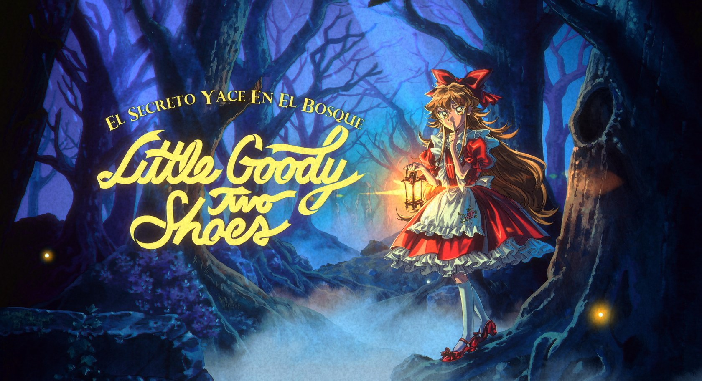
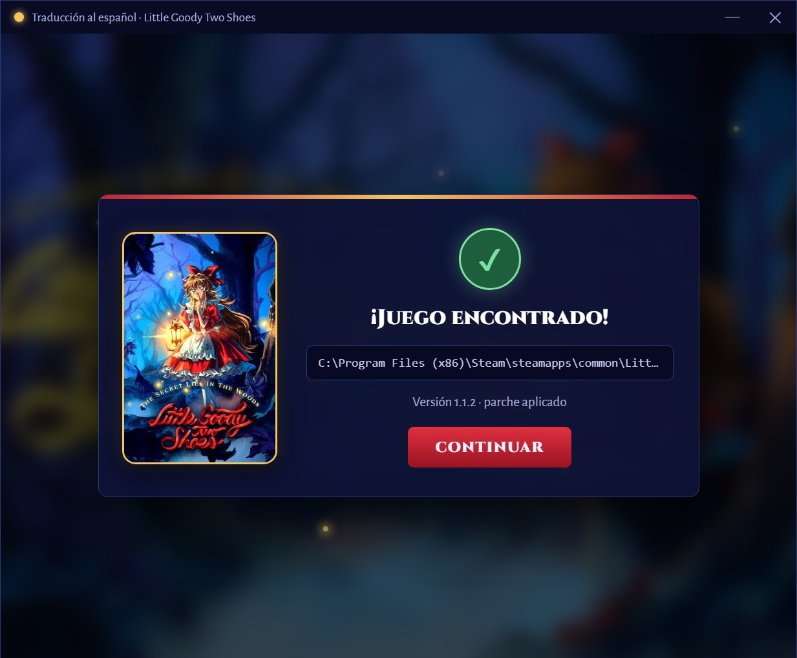
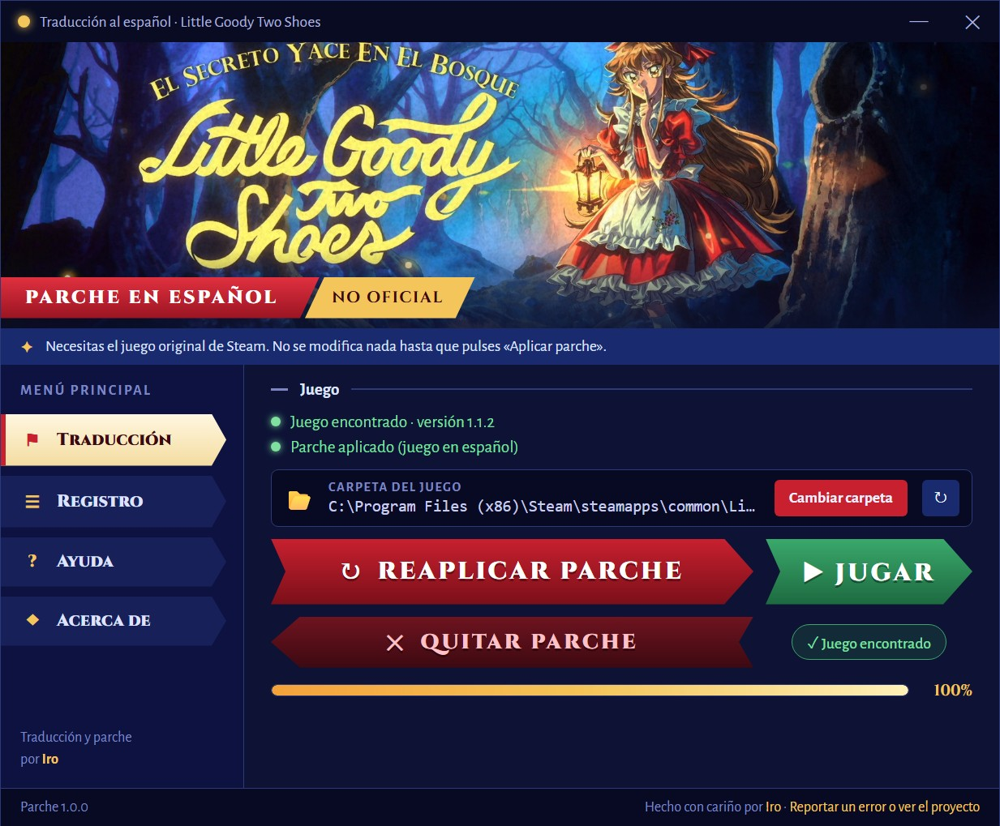

<p align="center">
  
</p>

<h1 align="center">Little Goody Two Shoes — Traducción al español</h1>

<p align="center">
  Traducción no oficial para fans al <b>español latinoamericano</b>, hecha por <b>Iro</b>.
</p>

<p align="center">
  <a href="../../releases/latest"></a>
  <a href="../../releases"></a>
  
  
</p>

<p align="center">
  
</p>

<p align="center">
  <a href="../../releases/latest"></a>
</p>

El parche se aplica **directamente a los archivos del juego**: después lo abres desde Steam como siempre y está en español de forma nativa, sin programas externos, mods ni nada ejecutándose aparte.

> [!NOTE]
> Proyecto **no oficial** y sin fines de lucro, sin relación con AstralShift ni con Square Enix. Necesitas el juego original comprado en Steam. Este repositorio **no contiene archivos del juego**: el parche modifica tu propia copia.

## 📸 Capturas

<table>
  <tr>
    <td width="50%"></td>
    <td width="50%"></td>
  </tr>
  <tr>
    <td align="center"><sub>Busca el juego en tus bibliotecas de Steam</sub></td>
    <td align="center"><sub>Aplica, quita el parche o abre el juego con un clic</sub></td>
  </tr>
</table>

## 🎮 Aplicar el parche

**Necesitas:** Windows 10 u 11, el juego de Steam (probado con la versión 1.1.2) y unos 500 MB libres en el disco del juego. No necesitas instalar Python ni nada más.

1. Descarga **`Instalar-Traduccion-LGTS.zip`** de la [última versión](../../releases/latest) y extráelo (clic derecho → *Extraer todo*).
2. **Cierra el juego.**
3. Abre `Instalar-Traduccion-LGTS.exe`: busca el juego solo en tus bibliotecas de Steam; si lo tienes en otra carpeta, elige **Lo instalé en otra carpeta** (o **Cambiar carpeta**) y selecciona la carpeta `Little Goody Two Shoes`. Comprueba que sea el juego, su versión y que no esté abierto.
4. Presiona **Aplicar parche** y espera a que diga «¡Parche aplicado!» (unos 5 minutos). **No abras el juego mientras tanto.**
5. Pulsa **▶ Jugar** (o abre el juego desde Steam como siempre). No hay que elegir idioma: el español reemplaza al inglés.

La misma ayuda de abajo está en la pestaña **Ayuda** del programa, y **Registro** muestra lo que hizo.

## ❓ Ayuda

<details>
<summary><b>📀 ¿Necesito el juego original?</b></summary>

Sí. El parche solo añade los textos en español a tu copia de Steam.
</details>

<details>
<summary><b>↩️ ¿Cómo vuelvo al inglés?</b></summary>

Abre el programa y pulsa **Quitar parche**: devuelve los archivos originales desde el respaldo. Si no hay respaldo, usa en Steam: clic derecho en el juego → *Propiedades → Archivos instalados → Verificar integridad*.
</details>

<details>
<summary><b>🔄 El juego se actualizó y salen textos en inglés</b></summary>

Las actualizaciones de Steam reemplazan los archivos con el parche. Vuelve a pulsar **Aplicar parche**. Si la versión es nueva, se te avisará; puede que necesites una versión nueva del parche.
</details>

<details>
<summary><b>🔍 No encuentra el juego</b></summary>

Pulsa **Cambiar carpeta** (o **Lo instalé en otra carpeta**) y elige la carpeta `Little Goody Two Shoes` (la que contiene `LGTS.exe`). En Steam la encuentras con clic derecho en el juego → *Administrar → Ver archivos locales*.
</details>

<details>
<summary><b>🛡️ Windows o el antivirus muestran un aviso</b></summary>

El programa no está firmado, así que Windows puede decir «Windows protegió su PC»: elige **Más información → Ejecutar de todas formas**. Algunos antivirus marcan por error los programas hechos con Python; el código completo está en este repositorio y el `.exe` lo genera GitHub Actions a partir de él (cada versión incluye su suma SHA-256).
</details>

<details>
<summary><b>💾 ¿Qué cambia en mi PC?</b></summary>

Solo archivos del juego: se añade la traducción al final de `data.unity3d` y se reescriben unos paquetes pequeños y `Assembly-CSharp.dll`. Antes guarda los originales en la carpeta `respaldo_traduccion_es`, dentro de la del juego; no la borres mientras el parche esté aplicado. Más detalles en **⚙️ Cómo funciona**, más abajo.
</details>

<details>
<summary><b>🐞 Encontré algo en inglés o un error</b></summary>

Repórtalo con una captura abriendo un [issue](../../issues/new/choose). ¡Ayuda mucho!
</details>

## 🐞 Reportar un error

Si ves algo en inglés, cortado, encimado o con letras raras, abre un [issue](../../issues/new/choose) con una **captura** y dónde aparece. ¡Toda ayuda cuenta!

## ⚙️ Cómo funciona

El programa no reemplaza el juego por una copia: aplica el parche sobre tus archivos.

- `LGTS_Data/data.unity3d` (6 GB) **no se reescribe**: se añaden al final las partes traducidas y un índice nuevo. Así quitar el parche es solo recortar lo añadido.
- Se reescriben los paquetes pequeños de `StreamingAssets/AssetBundles` y `Managed/Assembly-CSharp.dll`.
- Antes de cambiar nada guarda los originales en `respaldo_traduccion_es`, dentro de la carpeta del juego (unos 3 MB). **No la borres** mientras el parche esté aplicado. Como está junto al juego, cualquier copia del programa la encuentra, aunque la abras desde otra cuenta de Windows.
- El registro de lo que hizo queda en `%LOCALAPPDATA%\LGTS-Parche-Traduccion-Espanol\instalador.log`.

| Carpeta | Qué hay |
|---|---|
| 📁 `traduccion/` | La traducción: diálogos (`es/`), textos fijos, textos del código, subtítulos, guiones e imágenes traducidas |
| 📁 `datos/` | Dónde está cada texto, imagen y fuente dentro del juego |
| 📁 `herramientas/` | El motor del parche (Python) |
| 📁 `app/` | El programa con ventana: `instalador.py`, su ventana (`ui/index.html`, que se muestra con pywebview y el motor WebView2 de Windows) y la configuración de PyInstaller |

### 🛠️ Generar el .exe desde el código

```bash
pip install -r requirements.txt
pyinstaller app/instalador.spec --noconfirm
```

El `.exe` queda en `dist/`. Al publicar una etiqueta `vX.Y.Z`, GitHub Actions lo genera, lo comprime en `Instalar-Traduccion-LGTS.zip` (con su suma SHA-256) y lo sube a Releases.

## 🙌 Créditos

- **Iro**: traducción, herramientas y parche.
- Little Goody Two Shoes © AstralShift / Square Enix Collective.

## 📜 Licencia

[](LICENSE)
[](https://creativecommons.org/licenses/by-nc-sa/4.0/deed.es)
[](herramientas/fuentes/OFL.txt)

- Programa y motor del parche (`app/`, `herramientas/`): [MIT](LICENSE).
- Traducción al español (`traduccion/`): [CC BY-NC-SA 4.0](https://creativecommons.org/licenses/by-nc-sa/4.0/deed.es). Puedes compartirla y modificarla citando el proyecto, sin uso comercial.
- Fuentes Merriweather, Cinzel y Alegreya Sans: [SIL Open Font License](herramientas/fuentes/OFL.txt) (ver también `app/ui/fuentes/`).
- El juego, sus textos originales y sus imágenes (banner, póster y capturas) pertenecen a AstralShift y Square Enix.

<p align="center"><sub>Hecho con cariño por <b>Iro</b> ✦</sub></p>
